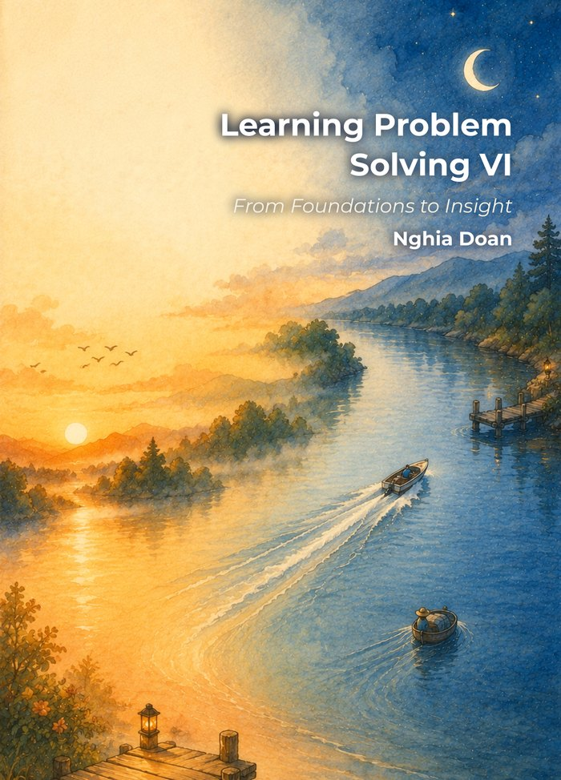
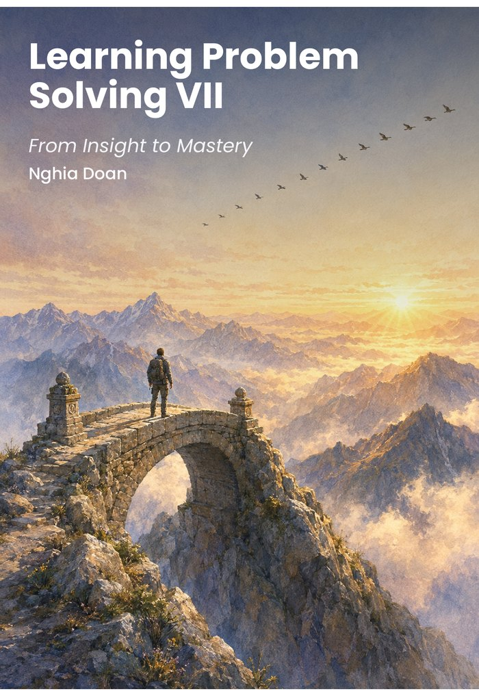
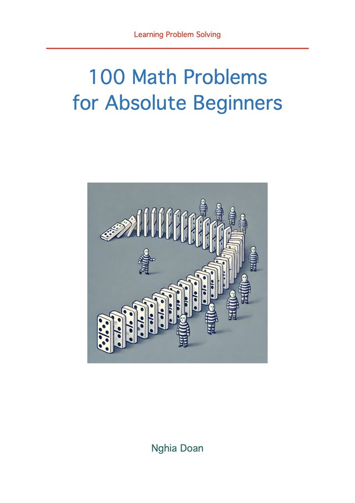

# Math Club & Competitions

A global mathematics club for students in Grades 4–12. Founded in Canada by Nghia Doan, MCC has grown over more than a decade from a small group of curious students into an international community spanning nine countries.

We teach problem solving, not formulas. Our students learn to read a problem carefully, experiment with small cases, build and test a conjecture, and write an argument that convinces. They do it together, in teams, and they take that habit into national and international competition.

[See the programs](./programs.md){: .btn}
[Meet the team](./organization.md){: .btn .secondary}
[Order the books](./books.md){: .btn .secondary}

## 📣 MCC now welcomes new members all year round

The 2026-2027 school year began on **8 September 2026**, and **new members can join at any point during the school year**. Each team follows its own personalised pace through the curriculum, with **[LPS VI and LPS VII](./books.md)** as the two textbooks, so a team that joins mid-year simply starts at Chapter 1.

Day-to-day organisation — team assignments, regional contacts, the testing workflow, and the weekly Sunday session — is run by the **Parents' Association**, under Ms. Minh Thu.

[How to join](./register.md){: .btn}
[Meet the team & find your contact](./organization.md){: .btn .secondary}
[See how the programme works](./programs.md){: .btn .secondary}

**📣 MCC nhận thành viên mới quanh năm.** Năm học 2026-2027 đã khai giảng ngày **8 tháng 9 năm 2026**, và **các em có thể tham gia vào bất kỳ thời điểm nào trong năm học**. Mỗi đội học theo nhịp độ cá nhân hóa riêng qua bộ giáo trình **[LPS VI và LPS VII](./books.md)**, nên một đội vào giữa năm chỉ đơn giản bắt đầu từ chương 1.

Việc tổ chức hằng ngày — phân đội, đầu mối liên lạc theo khu vực, quy trình đăng ký học/thi, và buổi sinh hoạt Chủ nhật hàng tuần — do **Hội Phụ huynh** phụ trách, dưới sự điều phối của Cô Minh Thu.

[Cách tham gia](./register.md){: .btn}
[Xem đầu mối liên lạc](./organization.md){: .btn .secondary}
[Xem chương trình học hoạt động ra sao](./programs.md){: .btn .secondary}

## Purple Comet 2026 — three teams first in the world

  
<b>3</b>MCC teams ranked #1 worldwide

  
<b>4,804</b>competing teams

  
<b>86</b>countries

  
<b>10</b>years of MCC at Purple Comet

MS ONE and MS TWO both scored a perfect 20/20 and HS ONE a perfect 30/30, each tying for World Champion; MS THREE earned an Honorable Mention at 19/20.

[The 2026 teams and student profiles](./purple-comet-2026.md){: .btn}
[Our results since 2019](./history.md){: .btn .secondary}

## The four training tracks

Students work in pairs, moving through the curriculum at their own pace: study a chapter, submit a team assignment, review the official solutions, then sit a team test — as often as weekly, or as seldom as once every three weeks. Every track follows the same rhythm; what changes is the difficulty and the length of the test.

  

    Entry
    <h3><a href="./t1">T1 — Foundations</a></h3>
    
The entry point into collaborative contest training. Learning to read a problem, choose a strategy, and write a complete solution with a partner.

    
<strong>LPS VI</strong> · 5–7 hrs/week · 90-minute tests

  

  

    Contest
    <h3><a href="./t2">T2 — Foresight</a></h3>
    
Harder contest problems that need several ideas joined together. Comparable to AMC 8/10 and national qualifiers.

    
<strong>LPS VI</strong> · 5–7 hrs/week · 120-minute tests

  

  

    Olympiad
    <h3><a href="./t3">T3 — Combat</a></h3>
    
National olympiad training. Standard olympiad theorems, unfamiliar problems broken into solvable parts, rigorous written proof.

    
<strong>LPS VII</strong> · 6–7 hrs/week · 150-minute tests

  

  

    Mastery
    <h3><a href="./t4">T4 — Mastery</a></h3>
    
The capstone. Advanced technique, professional solution writing, and the stamina for multi-hour contests. Aimed at team selection tests and the IMO.

    
<strong>LPS VII</strong> · 7–8 hrs/week · 180-minute tests

  

## The curriculum

  

    Middle School
    
    <h3>LPS VI — From Foundations to Insight</h3>
    
54 chapters in 5 parts, 217 themed sections, <strong>1,395 problems</strong> — 998 worked examples and 397 exercises. 672 pages, A4. The textbook for T1 and T2.

    
<a href="https://www.lulu.com/shop/nghia-doan/learning-problem-solving-vi/hardcover/product-m2ezqjj.html">Order from Lulu →</a>

  

  

    High School
    
    <h3>LPS VII — From Insight to Mastery</h3>
    
55 chapters in 5 parts, 216 themed sections, <strong>1,326 problems</strong> — 922 worked examples and 404 exercises. 648 pages, A4. The textbook for T3 and T4.

    
<a href="https://www.lulu.com/shop/nghia-doan/learning-problem-solving-vii/hardcover/product-2mnpyy4.html">Order from Lulu →</a>

  

  

    Starting out
    
    <h3>100 Math Problems for Absolute Beginners</h3>
    
Not the course book — the one that comes before it. For students just starting, or with the club a year or less. English and Vietnamese editions.

    
<a href="./books">Details and ordering →</a>

  

  

    Tests
    <h3>Tests</h3>
    
226 papers and over 1,350 problems across four levels — and, at the end of the year, the yearbook the students write with us.

    
<a href="./tests">How testing works →</a>

  

## The Coding Programme

**[TOML](./toml.html)** is now the home of the club's coding programme, open to Middle School and High School students alike: three problems a week at your level, solved and submitted online with feedback on each one, plus a coding competition every few weeks as part of the rotating weekly Sunday session.

## The club in 2026-2027

Starting this year, MCC is becoming a more structured organisation, moving from a flexible coaching model to a **Comprehensive Research & Olympiad Club**:

* **Leadership** — the **[Parents' Association](./organization.md)** runs the club's day-to-day organisation, alongside **Teacher Nghia**, who leads the curriculum and academics. There is no separate board or officer structure.
* **Formal membership** — an annual membership of $100, giving the club a stable foundation for advanced resources.
* **Global on-site events** — two annual in-person "MCC Olympiads", in the USA and in Europe.

**Câu Lạc Bộ Toán Học Toàn Cầu MCC** khởi đầu tại Canada và đã phát triển thành một cộng đồng quốc tế sôi động. Trong hơn một thập kỷ, chúng tôi đã đồng hành cùng học sinh qua các buổi huấn luyện và thử thách hàng tuần. Thành tích của MCC đã được khẳng định trên đấu trường quốc tế: năm 2026, ba đội của câu lạc bộ cùng đạt **Hạng Nhất Thế Giới** tại Purple Comet Math Meet với điểm tuyệt đối.

**Sự chuyển mình cho năm học 2026-2027.** Bước sang năm học 2026-2027, MCC chính thức chuyển sang mô hình **Câu lạc bộ Nghiên cứu & Thi đấu chuyên nghiệp**:

* **Điều hành** — **[Hội Phụ huynh](./organization.md)** phụ trách tổ chức hằng ngày của câu lạc bộ, cùng với **Thầy Nghĩa**, người phụ trách chương trình học và chuyên môn. Không có ban điều hành hay chức danh nào khác.
* **Hệ thống hội viên** — chế độ hội viên thường niên ($100/năm) giúp duy trì các nguồn lực cao cấp và hạ tầng học tập.
* **Olympic trực tiếp** — tổ chức 2 kỳ thi Olympic quy mô lớn mỗi năm tại Mỹ và Châu Âu.

[Xem đầu mối liên lạc Hội Phụ huynh](./organization.md)

## Already a member?

Find your regional contact on the **[Organization](./organization.md)** page.

*Đã là thành viên?* Xem đầu mối liên lạc theo khu vực tại trang **[Hội Phụ huynh](./organization.md)**.

## How to join

**You can join at any time during the school year (September to June).** Form a team of two, then write to the Parents' Association — your regional coordinator, or anyone you already know: [Ms. Minh Thu](mailto:tpham151st@gmail.com), [Ms. Ha](mailto:lengocha45@gmail.com), [Ms. Thoa](mailto:thoamai.nguyen84@gmail.com), [Mr. Son](mailto:sonhho@gmail.com), [Ms. Ngoc Anh](mailto:tranngocanh0910@gmail.com), or [Ms. Quynh Anh](mailto:vquynhanh80@gmail.com). An entrance test is prepared for you when your registration arrives. You can also join the [MCC mailing list](https://groups.google.com/g/mcc-school-year-2026-2027).

[How to join](./register.md){: .btn}

*Muốn tham gia?* Các em có thể tham gia vào bất kỳ thời điểm nào trong năm học (tháng 9 đến tháng 6). Lập đội hai người, rồi liên hệ Hội Phụ huynh — người phụ trách khu vực, hoặc bất kỳ ai gia đình quen: [Cô Minh Thu](mailto:tpham151st@gmail.com), [Cô Hà](mailto:lengocha45@gmail.com), [Cô Thoa](mailto:thoamai.nguyen84@gmail.com), [Anh Sơn](mailto:sonhho@gmail.com), [Cô Ngọc Anh](mailto:tranngocanh0910@gmail.com), [Cô Quỳnh Anh](mailto:vquynhanh80@gmail.com). Đề thi đầu vào sẽ được soạn khi nhận được đăng ký. Có thể tham gia thêm [Danh sách thư MCC](https://groups.google.com/g/mcc-school-year-2026-2027).

## Everything else

* [**Organization**](./organization.md) — the Parents' Association, regional contacts, and how the year is run.
* [**Programs**](./programs.md) — how the year works, entrance and reassessment, the calendar, awards.
* [**Books**](./books.md) — the full curriculum and how to order it.
* [**Video Lectures**](./video-lectures.md) — one recorded lecture per chapter of LPS VI and LPS VII, for club members.
* [**Tests**](./tests.md) — the test format, submission rules, grading, and the yearbook.
* [**Purple Comet 2026**](./purple-comet-2026.md) — teams, results, and student profiles.
* [**Competition history**](./history.md) — our Purple Comet results, 2019 to 2026.
* [**Join MCC**](./register.md) — how to join at any time during the school year, and who to write to.
* [**Archive**](./archive.md) — past curricula, standings, entrance tests, and earlier LPS volumes.
