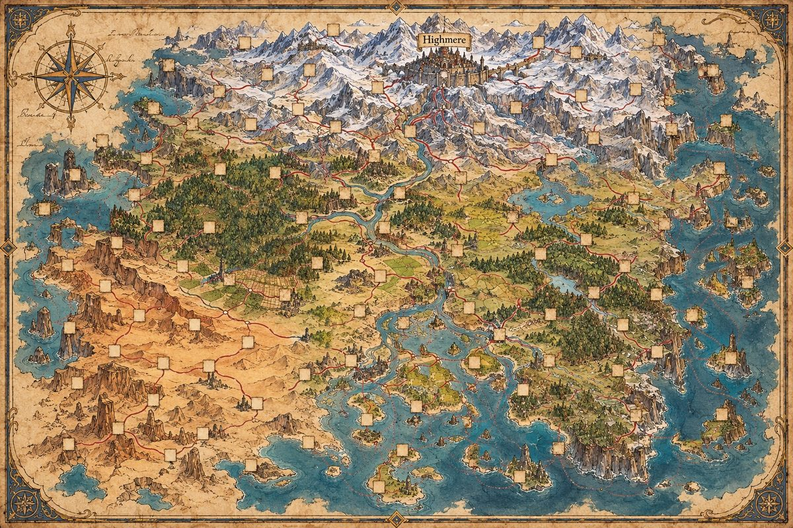
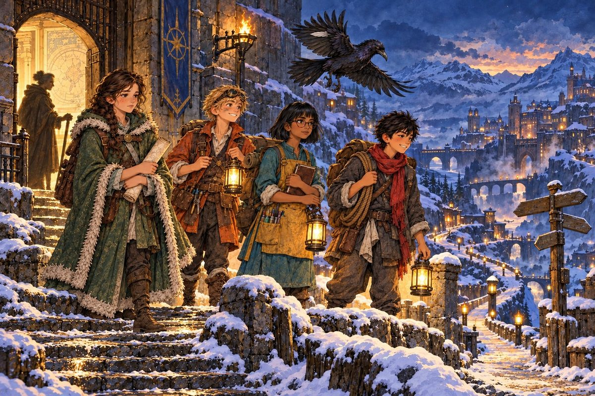

# 100 Puzzles — the MCC award book

A hundred places on the Great Map are still blank. In each of them someone is stuck — a gate that will not open, a lantern that will not light, a sum nobody can make come right. This year, the club's award winners set out to help.

*100 Puzzles* is an illustrated book of original story puzzles in mathematics, logic and science, written for MCC and given to the club's award winners. Each puzzle is a short story with its own picture, a clear list of what is allowed, and two or three questions that climb in difficulty. Hints and complete solutions, written for students, are at the back.

## Read it first

  

    English
    <h3>Leaflet and sample</h3>
    
A letter from Master Orla, the keeper of the Great Map, and what parents need to know. The sample holds the Prologue and Puzzle 8, <em>The Swinging Island</em>, with its hint and full solution.

    
<a class="btn" href="./award-book/leaflet-en.pdf">Leaflet (PDF)</a>
       <a class="btn secondary" href="./award-book/sample-en.pdf">Sample chapter (PDF)</a>

  

  

    Tiếng Việt
    <h3>Tờ giới thiệu và bản đọc thử</h3>
    
Lá thư của Sư phụ Orla, người giữ Đại Bản Đồ, và những điều phụ huynh cần biết. Bản đọc thử gồm phần Mở đầu và Câu đố 8, <em>Hòn Đảo Đu Đưa</em>, kèm gợi ý và lời giải đầy đủ.

    
<a class="btn" href="./award-book/leaflet-vi.pdf">Tờ giới thiệu (PDF)</a>
       <a class="btn secondary" href="./award-book/sample-vi.pdf">Chương đọc thử (PDF)</a>

  

## What it is

* **A gift, earned.** The book is given to the club's award winners. Volume 1 (puzzles 1–50) goes to the first-semester winners in December 2026; Volume 2 (puzzles 51–100) follows.
* **For several kinds of reader.** Students from about Grade 6 upwards, with puzzles that also stretch high-school students. Each puzzle is marked *Explorer*, *Investigator* or *Master*, so every reader finds their level. Any science a puzzle needs is explained inside it.
* **One story.** The hundred puzzles are one journey across a map: four apprentices, a small dragon and a raven filling in the blank places. Every puzzle can still be read and solved on its own.
* **English or Vietnamese.** Each winner chooses. Both editions have the same pictures, map and puzzles. Places carry names that sound right in each language, and every book lists both, so brothers, sisters and friends with different editions can talk about the same puzzles.

**100 Câu Đố — sách tặng thưởng của MCC.** Trên Đại Bản Đồ vẫn còn một trăm ô trống. Ở mỗi nơi ấy, có người đang gặp rắc rối: một cánh cổng không chịu mở, một ngọn đèn không chịu cháy, một phép tính chẳng ai làm cho ra. Năm nay, các em đoạt giải của câu lạc bộ sẽ lên đường giúp họ.

*100 Câu Đố* là một cuốn sách có tranh minh họa, gồm những câu đố kể chuyện hoàn toàn mới về toán học, logic và khoa học, viết riêng cho MCC và trao tặng cho các em đoạt giải. Mỗi câu đố là một câu chuyện ngắn với bức tranh riêng, một danh sách rõ ràng những gì được phép làm, và hai hoặc ba câu hỏi khó dần. Gợi ý và lời giải đầy đủ, viết cho học sinh, nằm ở cuối sách.

* **Món quà phải giành được.** Sách được trao cho các em đoạt giải. Tập 1 (câu đố 1–50) trao cho các em đoạt giải học kỳ một vào tháng 12 năm 2026; Tập 2 (câu đố 51–100) sẽ ra sau.
* **Cho nhiều lứa tuổi.** Học sinh từ khoảng lớp 6 trở lên, với những câu đố đủ sức thử thách cả học sinh trung học phổ thông. Mỗi câu đố được xếp hạng *Nhà thám hiểm*, *Nhà điều tra* hoặc *Bậc thầy*. Kiến thức khoa học nào cần dùng đều được giải thích ngay trong câu đố.
* **Một câu chuyện.** Một trăm câu đố là một cuộc hành trình trên tấm bản đồ: bốn người học trò, chú rồng nhỏ Than Hồng và cô quạ Lông Bạc đi lấp đầy những ô trống. Mỗi câu đố vẫn có thể đọc và giải riêng.
* **Tiếng Anh hoặc tiếng Việt.** Mỗi em được chọn. Hai bản có cùng tranh vẽ, bản đồ và câu đố; tên nơi chốn được đặt cho hay trong từng thứ tiếng, và sách nào cũng có bảng đối chiếu tên, để anh chị em và bạn bè đọc hai bản khác nhau vẫn cùng bàn về những câu đố như nhau.

**An extra copy?** Families who would like one can ask their [regional coordinator](./organization.md); ordering details will appear here when Volume 1 is printed.

*Gia đình nào muốn có thêm sách xin liên hệ coordinator khu vực; cách đặt mua sẽ được đăng tại đây khi Tập 1 in xong.*
