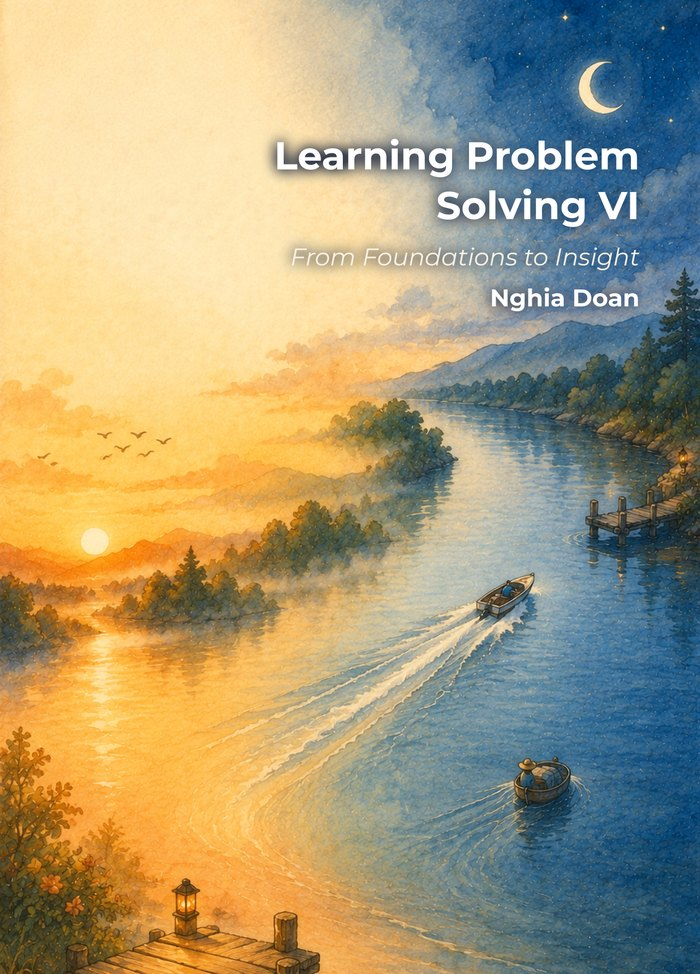
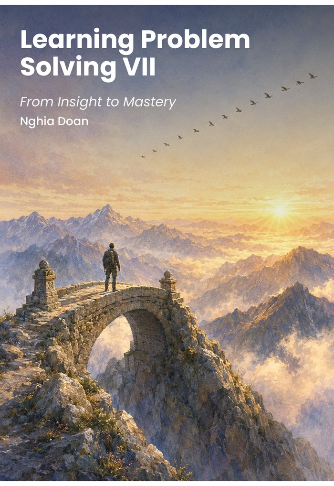
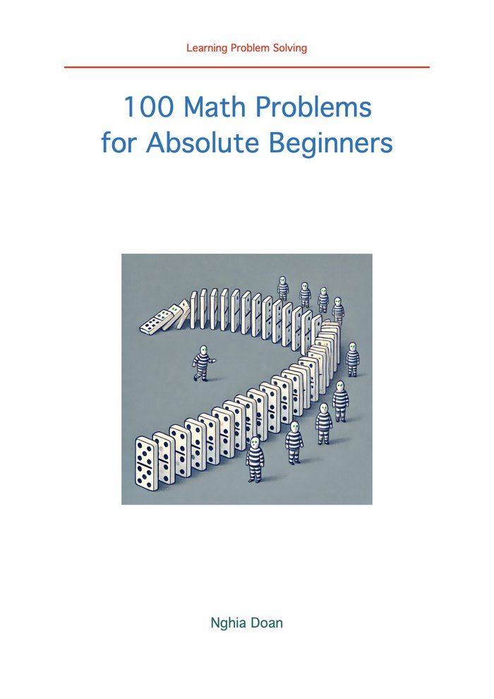
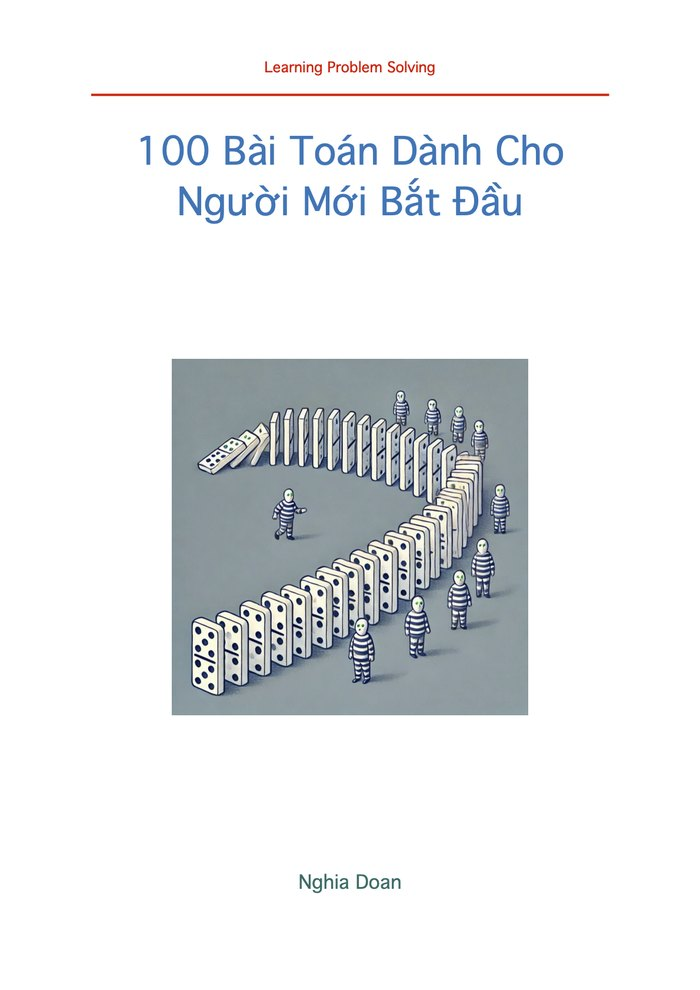
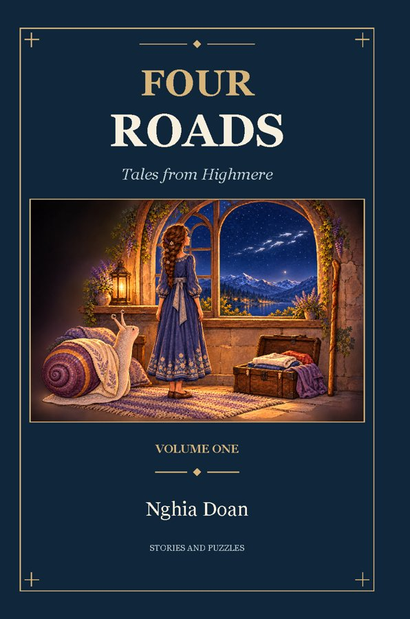
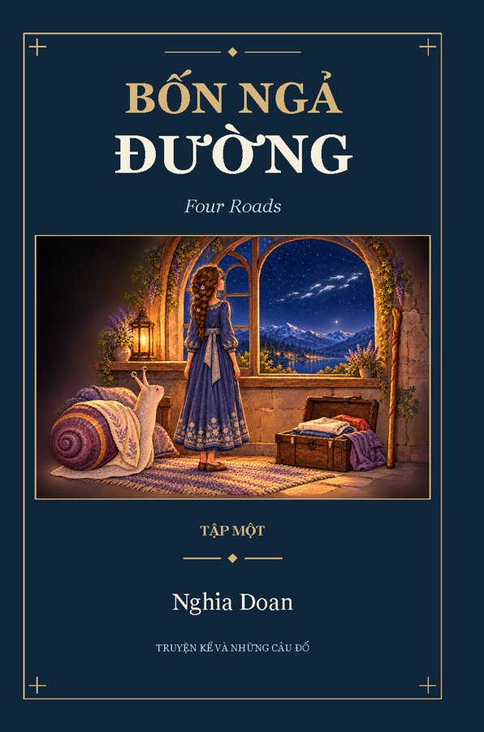

# The MCC Curriculum

The club's curriculum is **Learning Problem Solving VI and VII** — two volumes covering four years of training. Around them sit an entry book for students who are just starting out, a book of stories and puzzles, the tests and the yearbook, and a free online course.

*Mỗi hành trình toán học đều bắt đầu từ một tia sáng tò mò. Để giúp học sinh khởi đầu đúng hướng, chúng tôi đã thiết kế một lộ trình phát triển rõ ràng.*

## 1. The main curriculum — Learning Problem Solving VI & VII

  

    Middle School · T1–T2
    
    <h3>LPS VI — From Foundations to Insight</h3>
    
<strong>54 chapters</strong> in five parts, four themed sections each — <strong>217 sections</strong> in all. 
       <strong>1,395 problems</strong>: 998 worked examples and 397 exercises. 
       <strong>672 pages, A4.</strong>

    
<a class="btn" href="https://www.lulu.com/shop/nghia-doan/learning-problem-solving-vi/hardcover/product-m2ezqjj.html">Order from Lulu</a>

  

  

    High School · T3–T4
    
    <h3>LPS VII — From Insight to Mastery</h3>
    
<strong>55 chapters</strong> in five parts, <strong>216 themed sections</strong>. 
       <strong>1,326 problems</strong>: 922 worked examples and 404 exercises, most solutions rewritten from scratch. 
       <strong>648 pages, A4.</strong>

    
<a class="btn" href="https://www.lulu.com/shop/nghia-doan/learning-problem-solving-vii/hardcover/product-2mnpyy4.html">Order from Lulu</a>

  

### How the books are built

* Every chapter opens with **a puzzle worth arguing about at dinner**, then its themed sections.
* Roughly **30% of each volume is exercise problems**, spread evenly across difficulty and across Algebra, Combinatorics, Geometry, and Number Theory. The rest are worked examples, every one with a complete solution.
* There are **no one-step, plug-in-the-formula problems**. Easy or hard, every problem asks the student to read, analyse, compute, and check. Routine drills belong to other curricula; these books assume you want to think.
* Each section teaches **one idea deeply**. You may notice several problems circling the same piece of theory before the next section opens a different door — that is the design, not a lack of variety. A little material above grade level is deliberately mixed in, so that students meet the next idea before they need it.
* Problems without an attributed source are the author's own.
* **Use each book twice, over two years.** The first year (T1, or T3) works through the whole book, chapter 1 to the last, on the Easy and Medium problems; the second year (T2, or T4) starts again at chapter 1, on the Medium and Hard problems. This is why T1 and T2 share the same 54 chapters, and T3 and T4 the same 55.

### The four-year path

Together the two volumes are a complete four-year programme: **109 chapters, 433 themed sections, 2,721 problems, 109+ tests, and four Purple Comet campaigns.** A strong student can take a volume in a year; for most, two years per volume is the right pace.

**This set is not for absolute beginners.** It assumes a student has already worked through Beast Academy or the AoPS Introductory series. Starting here without that footing is discouraging rather than useful.

### Ordering

Order directly from Lulu using the links above. **The price is the printing cost, rounded to the nearest unit** — the club takes nothing. Lulu prints in each country and ships domestically, which keeps both cost and delivery time reasonable.

Please tell the club when you order: if a discount code is available, we will pass it on. A **group order** is cheaper still, if a local group is willing to handle delivery — and it usually turns into coffee.

**Đặt sách.** Đặt trực tiếp từ Lulu theo đường dẫn ở trên. Giá đúng bằng giá in, làm tròn đến hàng đơn vị — câu lạc bộ không lấy gì thêm. Lulu in tại từng nước rồi giao hàng trong nước đó nên chi phí và thời gian giao hàng đều hợp lý.

Khi đặt xin nhắn cho câu lạc bộ — nếu có mã giảm giá chúng tôi sẽ chuyển ngay. Đặt theo nhóm còn rẻ hơn nữa, nếu có phụ huynh nhận việc giao sách tại chỗ.

**LPS VI: 54 chương, 217 chuyên mục, 1.395 bài (998 ví dụ + 397 bài tập), 672 trang A4. LPS VII: 55 chương, 216 chuyên mục, 1.326 bài (922 ví dụ + 404 bài tập), 648 trang A4.** Khoảng 30% là bài tập. Sách không có bài áp dụng công thức một bước ăn ngay; dù dễ hay khó, mỗi bài đều đòi hỏi đọc hiểu, phân tích, tính toán rồi kiểm tra. Mỗi quyển được học **hai lần** trong hai năm: năm đầu (T1, hoặc T3) học cả quyển, từ chương 1 đến chương cuối, với các bài Dễ và Trung bình; năm sau (T2, hoặc T4) học lại từ chương 1, với các bài Trung bình và Khó. Bộ hai quyển là một chương trình bốn năm: **109 chương, 433 chuyên mục, 2.721 bài toán, 109+ kỳ kiểm tra và 4 mùa Purple Comet.**

## 2. Starting out — *100 Math Problems for Absolute Beginners*

**This is not the main course book.** It is for students who are just beginning, or who have been with the club a year or less — the book that comes *before* LPS VI, not instead of it.

Before diving into complex theory, students need to fall in love with patterns and logic. How can we make mathematics more enjoyable? Not with dry lessons, and not with a series of drills, but with something that sparks curiosity — something that feels like solving a mystery, discovering a pattern, unlocking a secret. Over the past ten years I have taught hundreds of students, from beginners to competition-level learners, and I have learned one thing: **the right problem, explained the right way, can change everything.**

I would recommend the print edition — it is a beautiful, high-quality book. Contact the club for a print copy. If you would rather have the e-book, it is in your hands in five minutes.

  

    English edition
    
    <h3>100 Math Problems for Absolute Beginners</h3>
    
100 problems, each chosen to teach one idea and explained the way it would be explained at a table, not in a lecture.

    
<a class="btn" href="https://www.lulu.com/shop/nghia-doan/100-math-problems-for-absolute-beginners/ebook/product-p69y785.html">E-book from Lulu</a>

  

  

    Vietnamese edition · Bản tiếng Việt
    
    <h3>100 Bài Toán Dành Cho Người Mới Bắt Đầu</h3>
    
Cùng nội dung, viết bằng tiếng Việt, dành cho các em và phụ huynh muốn học bằng tiếng mẹ đẻ.

    
<a class="btn" href="https://www.lulu.com/shop/nghia-doan/100-b%C3%A0i-to%C3%A1n-d%C3%A0nh-cho-ng%C6%B0%E1%BB%9Di-m%E1%BB%9Bi-b%E1%BA%AFt-%C4%91%E1%BA%A7u/ebook/product-rm68v54.html">E-book từ Lulu</a>

  

**Đây không phải giáo trình chính.** Sách dành cho các em mới bắt đầu, hoặc mới tham gia câu lạc bộ từ một năm trở lại — là cuốn học *trước* LPS VI, không phải thay cho LPS VI.

Trước khi bước vào những lý thuyết phức tạp, học sinh cần yêu thích các quy luật và logic. Làm thế nào để Toán học trở nên thú vị hơn? Không phải là những bài giảng khô khan, cũng không phải một chuỗi bài luyện tập máy móc, mà là điều gì đó khơi gợi sự tò mò — như đang giải một bí ẩn, phát hiện một quy luật, mở khóa một điều bí mật. Trong 10 năm qua, tôi đã dạy hàng trăm học sinh — từ những em mới bắt đầu đến các bạn luyện thi cấp cao — và tôi rút ra một điều: **một bài toán phù hợp, được giảng giải đúng cách, có thể thay đổi mọi thứ.**

Tôi khuyên nên chọn bản in, vì đây là cuốn sách được thiết kế đẹp mắt với chất lượng cao — liên lạc với Câu Lạc Bộ để có bản in. Nếu muốn bản e-book, bạn nhận được sách chỉ sau 5 phút.

## 3. Stories and puzzles — *Four Roads* {#four-roads}

**The club's award book.** Mira, Bao, Tavi and Suri set out on four roads across Highmere. Past river landings, workshops and strange lands, every question opens a new road. Read straight through to follow the story, or stop with the characters and try each puzzle yourself. The puzzles use mathematics, logic and everyday science; hints and full solutions are in the book. For readers aged 10 and up.

**Volume One: 25 chapters, 75 puzzles.** The English and Vietnamese editions are checked line by line, so they have the same pictures, map, puzzles and answers. Brothers, sisters and friends with different editions can work on the same puzzles together.

  

    English edition
    
    <h3>Four Roads — Volume One</h3>
    
<strong>25 chapters, 75 puzzles</strong>, illustrated, with hints and full solutions. 
       <strong>306 pages, hardcover.</strong>

    
<a class="btn" href="https://www.lulu.com/shop/nghia-doan/four-roads/hardcover/product-w46rpd4.html">Order from Lulu</a>

    
<a class="btn secondary" href="./four-roads/leaflet-en.pdf">Leaflet (PDF)</a>
       <a class="btn secondary" href="./four-roads/sample-en.pdf">Chapters 1–4 (PDF)</a>

  

  

    Vietnamese edition · Bản tiếng Việt
    
    <h3>Bốn ngả đường — Tập một</h3>
    
<strong>25 chương, 75 câu đố</strong>, có tranh minh họa, gợi ý và lời giải đầy đủ. 
       <strong>297 trang, bìa cứng.</strong>

    
<a class="btn" href="https://www.lulu.com/shop/nghia-doan/b%E1%BB%91n-ng%E1%BA%A3-%C4%91%C6%B0%E1%BB%9Dng/hardcover/product-84894k5.html">Đặt sách từ Lulu</a>

    
<a class="btn secondary" href="./four-roads/leaflet-vi.pdf">Tờ giới thiệu (PDF)</a>
       <a class="btn secondary" href="./four-roads/sample-vi.pdf">Đọc thử chương 1–4 (PDF)</a>

  

The leaflet is one two-sided page for families. The sample holds the first four chapters in full, with their puzzles, hints and solutions.

**Sách tặng thưởng của câu lạc bộ.** Mira, Bao, Tavi và Suri lên đường trên bốn ngả đường khắp Highmere. Qua những bến sông, xưởng thợ và miền đất lạ, mỗi câu hỏi lại mở ra một con đường mới. Có thể đọc liền một mạch để theo câu chuyện, hoặc dừng lại cùng các nhân vật và tự giải từng câu đố. Các câu đố dùng toán học, logic và khoa học đời thường; gợi ý và lời giải đầy đủ có trong sách. Dành cho các em từ 10 tuổi trở lên.

**Tập một: 25 chương, 75 câu đố.** Bản tiếng Anh và bản tiếng Việt được đối chiếu từng dòng, nên có cùng tranh vẽ, bản đồ, câu đố và đáp số. Anh chị em và bạn bè đọc hai bản khác nhau vẫn cùng giải được những câu đố như nhau. Tờ giới thiệu là một trang hai mặt dành cho gia đình; bản đọc thử gồm trọn bốn chương đầu, có câu đố, gợi ý và lời giải.

## 4. The tests and the yearbook

Every chapter closes with its own test, and those tests are collected into the third book of the set — **226 papers and over 1,350 problems**, across all four levels. At the end of the year comes the yearbook, written together with the students.

[How testing works, and what goes in the yearbook →](./tests.md)

## 5. Free online: The Online Mathematics Laboratory

**[TOML](./toml.html)** teaches mathematics investigated with a programming tool: explore a problem computationally, explain what you see, then establish it with a proof. Bilingual, with runnable Python on every page — copy it to your machine or run it in the browser. Free, with no book to buy.

## 6. Earlier volumes

The Learning Problem Solving series began well before Volume VI. Volumes 1–3 and the Toolbox remain available, along with the annual school-year books.

* [**Learning Problem Solving, Volumes 1–3 and the Toolbox**](./lps-volumes.md)
* [**Annual school-year books, 2021–2025**](./annual-books.md)
